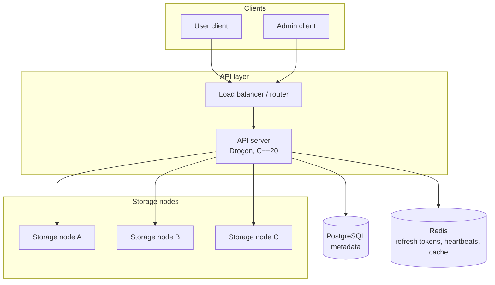

# Architecture

chunkvault splits files into fixed-size, content-addressed chunks, stores metadata in PostgreSQL, and places replica bytes on independent storage node processes. Clients talk only to the API layer. Storage nodes never accept end-user credentials.

## API server (Drogon, C++20)

The API server is the only public control plane. It authenticates callers, authorizes `user` and `admin` roles, chunks inbound file bytes, computes SHA-256 chunk IDs, records file and replica metadata in PostgreSQL, and drives PUT/GET/DELETE against storage nodes. It issues 15-minute JWT access tokens and rotating refresh tokens, and it is the process that decrements chunk reference counts and runs garbage collection. It must not persist object payload bytes on its own disk, must not treat Redis as the source of truth for file or replica membership, and must not expose storage-node URLs or internal replica placement to non-admin clients.

## Load balancer / router (inside the API layer)

The router sits inside the API process, not as a separate proxy product. It maps HTTP paths to controllers, applies request limits, and chooses which storage nodes receive a given chunk using live heartbeats and placement policy (replication factor 2 by default). It fans out replica writes and fails over reads to a remaining replica when a node is down. It must not authenticate users itself beyond passing the verified identity from the auth middleware, must not rewrite chunk IDs, and must not keep a private copy of blob data or token material.

## PostgreSQL (metadata)

PostgreSQL is the system of record for users, files, chunk catalogs, reference counts, replica assignments, and the durable storage-node registry. All upload, download, soft-delete, and GC decisions that change membership or ownership commit here. It must not store chunk payloads, refresh-token plaintext, or ephemeral node liveness. It must not be queried by storage nodes for authorization of end users.

## Redis (refresh tokens, node heartbeats, cache)

Redis holds hashed refresh tokens with TTL, storage-node heartbeat keys with TTL, and short-lived caches of file metadata and chunk location lists. A missing heartbeat is the liveness signal the router uses to skip a node. It must not be the authority for whether a file exists, whether a chunk is still referenced, or how many replicas are required. It must not store access-token JWT plaintext as a session table; access tokens are validated by signature and expiry. It must not store unhashed refresh tokens.

## Storage nodes A, B, and C (separate C++ processes)

Each storage node is an independent process that stores opaque bytes keyed by chunk ID. It implements `PUT /chunks/{id}`, `GET /chunks/{id}`, `DELETE /chunks/{id}`, and `GET /health`. On PUT it verifies that the body SHA-256 matches `{id}` and that the body is at most 4 MiB. It reports health and capacity through heartbeats consumed by the API. It must not chunk files, must not talk to PostgreSQL or issue JWTs, must not replicate to other nodes on its own, and must not accept deletes from anyone except the API server. Nodes A, B, and C are peers; none is a metadata leader.
