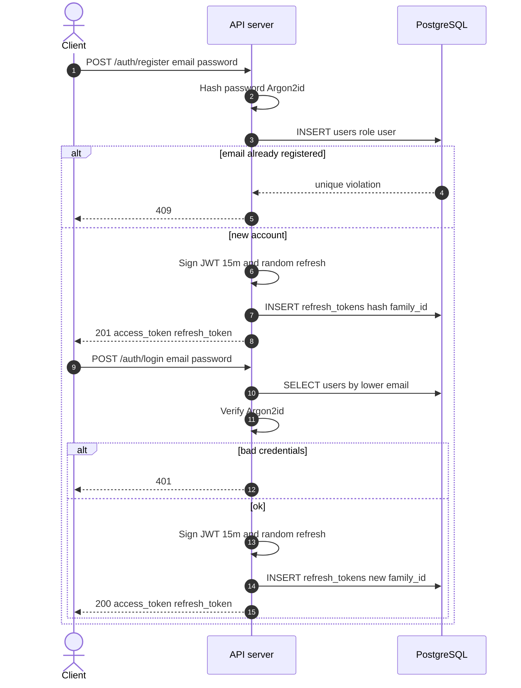
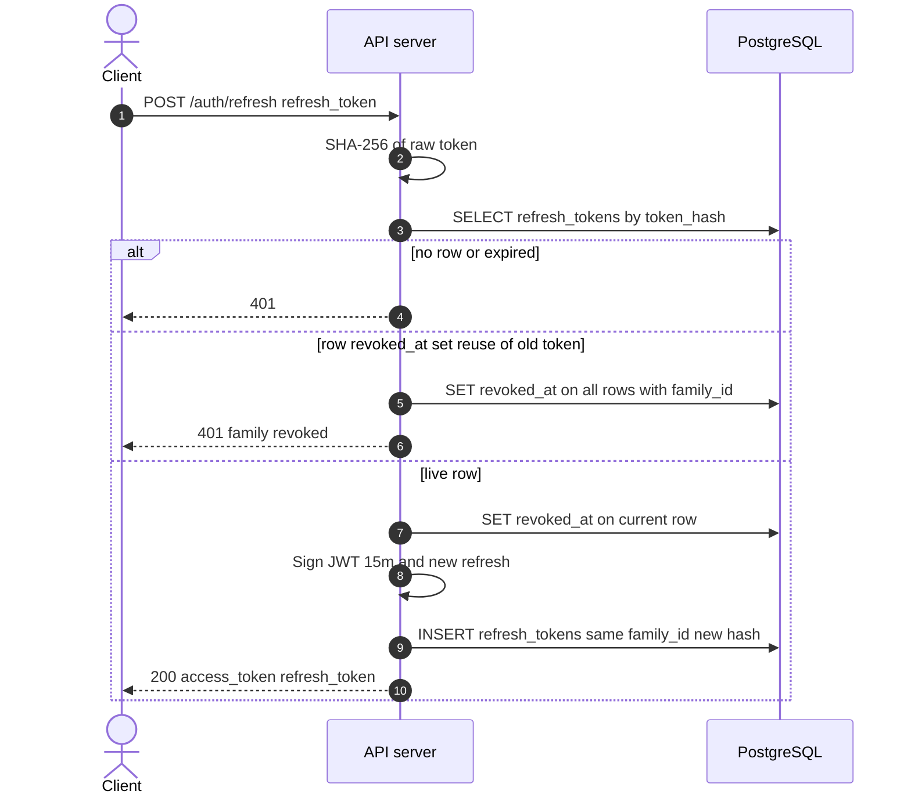
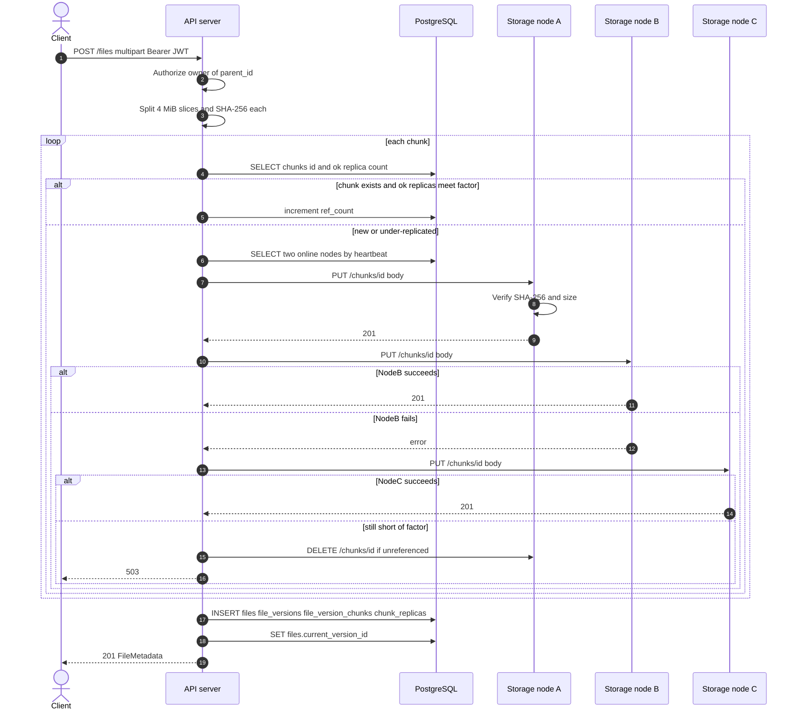
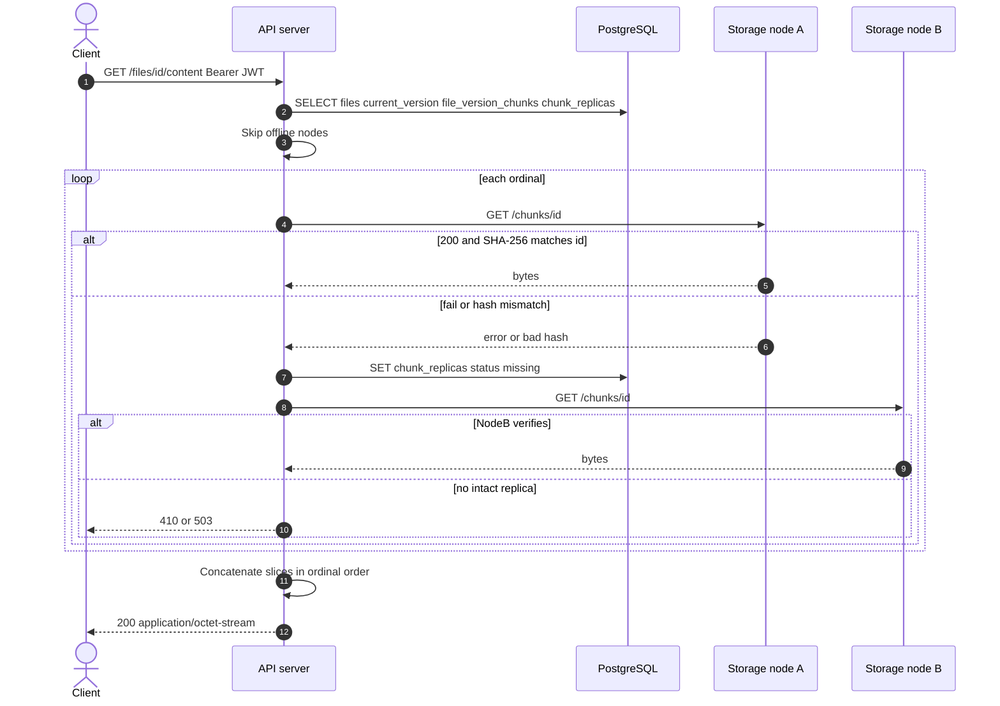
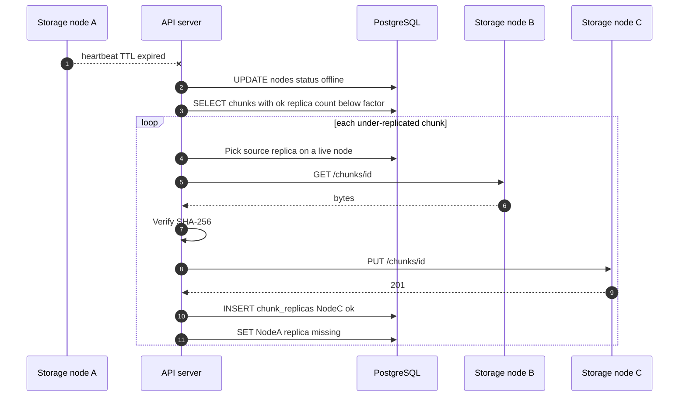
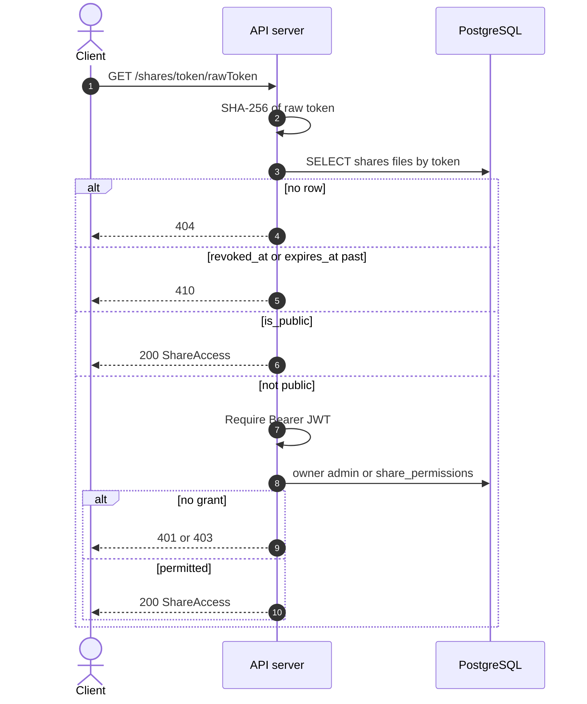

# Sequence diagrams

Flows below match [SDD.md](../design/SDD.md) and [schema.md](../design/schema.md). The API server is the only public participant. Storage nodes never see user JWTs. Refresh-token hashes and node status are stored in PostgreSQL; Redis remains a cache and short TTL heartbeat aid.

## 1. Registration and login

Register inserts a `users` row and issues the same token pair as login. Login looks up `lower(email)`, verifies Argon2id, and starts a new refresh `family_id`. The access JWT lasts 15 minutes and is not stored. Only SHA-256 of the refresh token is written to `refresh_tokens`.

## 2. Access token refresh

A valid refresh token is hashed and matched to a live `refresh_tokens` row. The API revokes that row, inserts a new hash in the same `family_id`, and returns a new JWT plus refresh token. If the presented hash belongs to a family but is already revoked, the API revokes every row in that family (reuse detection) and returns 401.

## 3. File upload

The API splits the body into 4 MiB slices (last slice may be shorter), sets each chunk id to SHA-256 of those bytes, and looks up `chunks`. If `ref_count` is already positive and two `ok` replicas exist, it only increments `ref_count`. Otherwise it PUTs the bytes to two live nodes, then commits `files`, `file_versions`, `file_version_chunks`, and `chunk_replicas`. If one node PUT fails, the router retries a third live node; if two writes still cannot succeed, it compensating-deletes any new unreferenced bytes and returns 503 without setting `current_version_id`.

## 4. File download

The API loads the file, `current_version_id`, ordered `file_version_chunks`, and `ok` replica rows, skipping nodes whose heartbeat or `status` is down. For each chunk it GETs one replica, recomputes SHA-256, and appends the bytes. A failed GET or hash mismatch marks that replica `missing` and retries another live replica. After all slices verify, the API returns the concatenated body; if no intact replica remains for a slice, it returns 410 or 503.

## 5. Node failure and re-replication

When node A misses its heartbeat TTL, the API sets `nodes.status` to `offline` and excludes it from placement. It then selects chunks whose `ok` replica count is below `replication_factor`, reads a surviving replica, PUTs the bytes to another online node, and inserts a new `ok` `chunk_replicas` row. Chunks with no remaining `ok` replica cannot be repaired and stay lost until an operator restores disk.

## 6. Share link access

The path token is hashed and looked up in `shares.token`. The API rejects missing, `revoked_at` set, or `expires_at` in the past (410). Public shares (`is_public`) need no JWT. Private shares require a bearer user who is the owner, an admin, or a row in `share_permissions`. On success the API returns file metadata; content download uses the same checks then the download replica path.

